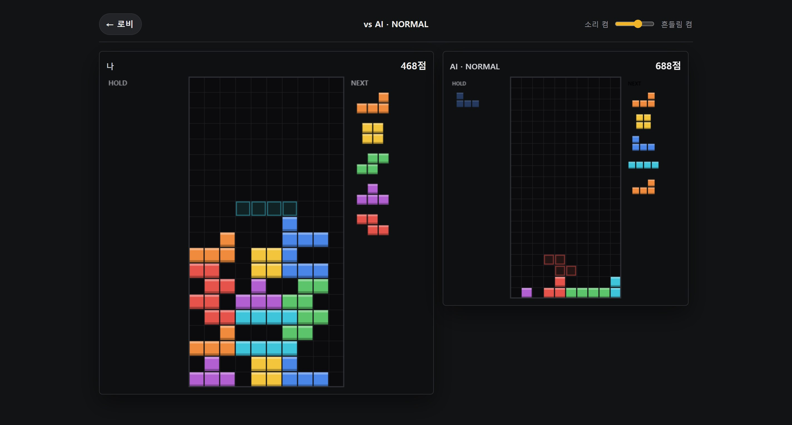
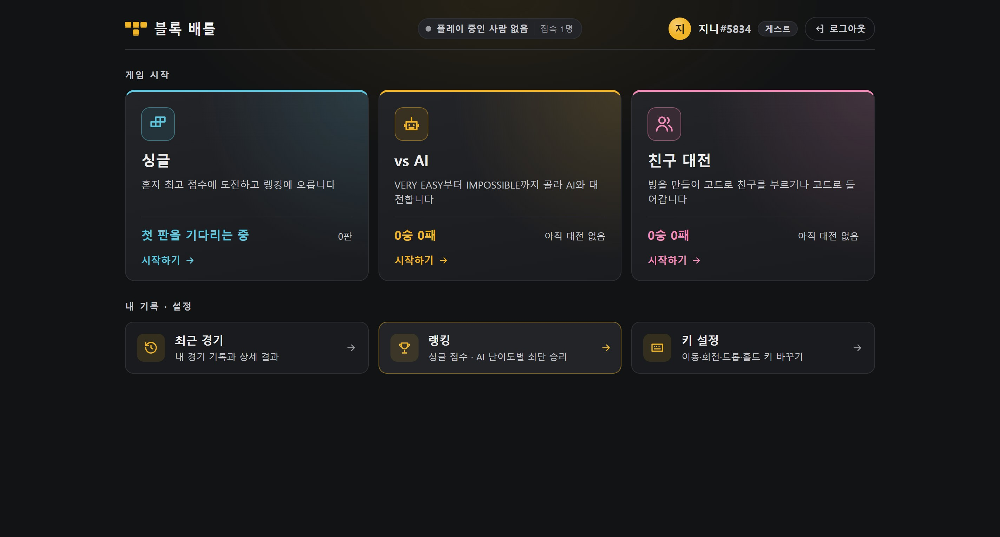
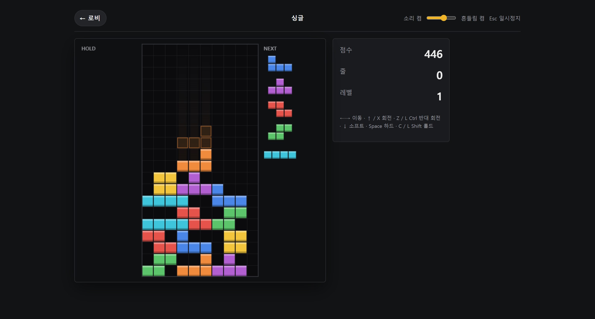
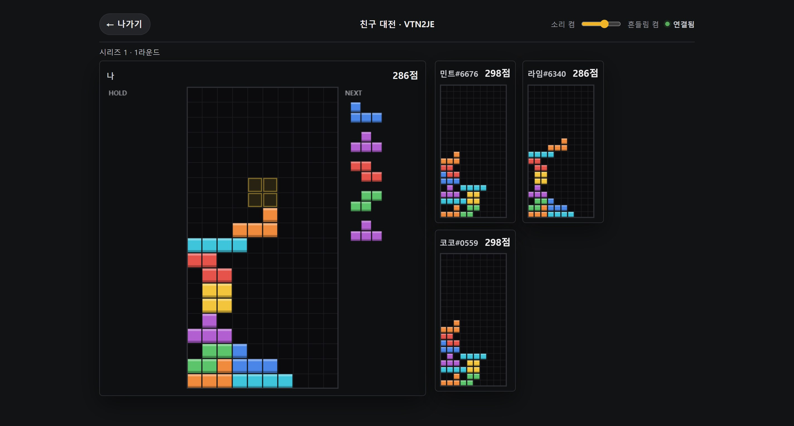
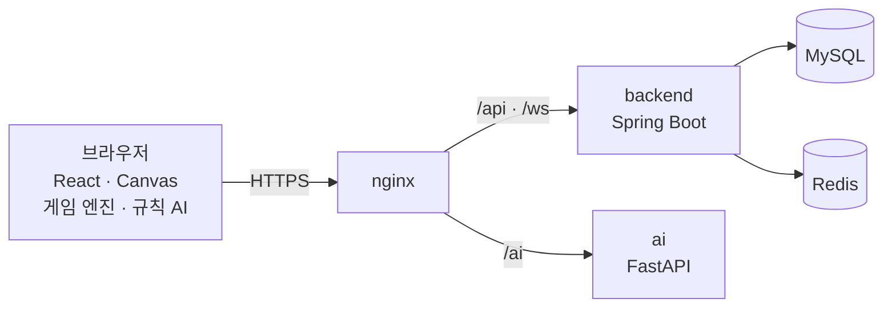

# 블록 배틀 (BlockBattle)

브라우저에서 하는 블록 낙하 퍼즐 대전 게임입니다. 혼자 점수를 겨루는 싱글, 컴퓨터와 겨루는 AI 대전, 방 코드로 친구를 불러 최대 4명이 겨루는 친구 대전이 있습니다.

> 지금은 운영 서버가 없습니다. 2026-11-21에 서버를 내렸고, 아래 "로컬에서 실행"대로 띄워 볼 수 있습니다.



## 화면

| 로비 | 싱글 | 친구 대전(4명) |
| --- | --- | --- |
|  |  |  |
| 모드를 고르고 내 전적과 접속 인원을 봅니다 | 점수·줄·레벨과 다음 블록 다섯 개가 보입니다 | 내 보드 옆에 상대 세 명의 보드가 실시간으로 보입니다 |

화면은 로컬에서 띄워 자동 입력으로 찍었습니다. 사람이 플레이한 장면이 아니어서 줄을 지운 기록이 없습니다.

## 게임 방식

- **싱글** — 혼자 플레이하고, 최고 점수가 랭킹에 오릅니다.
- **AI 대전** — 난이도 다섯 단계(VERY EASY ~ IMPOSSIBLE) 중 하나를 골라 컴퓨터와 겨룹니다.
- **친구 대전** — 방을 만들면 나오는 코드나 초대 링크로 2~4명이 모입니다. 줄을 한꺼번에 여러 개 지우면 상대 한 명의 보드 아래에 방해 줄이 올라갑니다. 두 명일 때는 한 판 승부와 3판 2선승 중에서 고르고, 끝나면 같은 방에서 다시 겨룰 수 있습니다.

로그인은 닉네임만 넣는 게스트 방식입니다.

## 구조



MySQL에는 회원·경기 결과·전적을, Redis에는 진행 중인 방과 경기 상태, 랭킹 캐시를 둡니다. 로컬에서 개발할 때는 nginx 자리를 Vite 개발 서버의 프록시가 맡습니다.

| 폴더 | 내용 | 스택 |
| --- | --- | --- |
| `backend` | REST·STOMP 서버(인증, 경기 저장, 방·친구 대전 판정, 오래된 기록 정리) | Java 21 · Spring Boot 3.5 · MySQL 8.4 · Redis 7.4 |
| `ai` | AI 대전의 다음 수를 계산하는 서버(`/ai/v1`) | Python 3.12 · FastAPI |
| `frontend` | 브라우저 화면, 게임 엔진, 규칙 AI | React 19 · TypeScript · Vite · Canvas |
| `shared/rules-fixtures` | 화면·서버·AI 서버가 함께 읽는 게임 규칙 테스트 데이터 | JSON |
| `infra` | 개발용 MySQL·Redis | Docker Compose |
| `deploy` | 운영 배포 설정과 스크립트 | Docker Compose · nginx |
| `loadtest` | 친구 대전 부하 테스트(두 명짜리 방 100개) | k6 |

## 설계에서 중요하게 둔 것

### 친구 대전의 결과는 서버가 다시 계산합니다

화면은 블록을 하나 놓을 때마다 블록 종류·놓은 위치·지운 줄 수를 서버로 보냅니다. 서버는 자기가 가진 보드에 그 수를 놓아 보드와 점수를 다시 계산하고, 상대에게 보낼 공격도 여기서 정합니다. 나올 차례가 아닌 블록이거나 놓을 수 없는 자리면 그 수를 받지 않습니다. 지운 줄 수가 서버 계산과 달라도 마찬가지입니다.

서버가 확인하지 않는 것도 있습니다. 블록이 그 자리까지 움직인 경로는 검사하지 않습니다. T-스핀(T 블록을 돌려서 끼워 넣어 점수와 공격을 더 받는 기술)은 블록이 끼인 자리인지만 서버가 판정하고, 마지막 동작이 회전이었는지는 화면이 보낸 값을 믿습니다.

싱글과 AI 대전은 판을 서버가 다시 계산하지 않고, 화면이 계산한 결과를 받아 저장합니다. 서버는 화면이 보낸 값들이 서로 맞는지와 걸린 시간 안에 낼 수 있는 기록인지를 검사합니다. 어긋나면 경기 기록은 남기되 싱글은 랭킹에서, AI 대전은 승패 전적에서 뺍니다. 그래서 이 두 모드의 기록은 친구 대전만큼 믿을 수 없습니다.

### AI 서버가 늦으면 화면이 대신 둡니다

AI 대전에서 컴퓨터의 다음 수는 AI 서버가 계산합니다. 응답이 제한 시간을 넘기거나 요청이 실패하면 화면에 들어 있는 규칙 AI가 그 수를 대신 두므로, AI 서버가 멈춰도 대전은 이어집니다.

### 따로 구현한 규칙을 같은 데이터로 테스트합니다

게임 규칙은 화면(TypeScript), 대전 서버(Java), AI 서버(Python)에 따로 구현돼 있습니다. 구현마다 자기가 쓰는 규칙만 갖고 있습니다. 서버에는 회전이 없고, AI 서버는 점수를 계산하지 않습니다.

구현끼리 어긋나지 않도록 `shared/rules-fixtures`의 같은 JSON으로 테스트합니다. 한 수를 놓았을 때 보드가 어떻게 바뀌고 몇 줄이 지워지는지는 세 구현이 모두 이 데이터로 확인합니다. 블록이 나오는 순서, 회전, 점수와 공격은 그 규칙을 가진 구현 둘씩 확인합니다.

## 배경: 어떻게 만들었나

BEEZ를 실제 개발에 써 보려고 만든 저장소입니다. [BEEZ](https://github.com/S15A108/BEEZ)는 AI 코딩 에이전트가 낸 작업 계획을 팀이 승인한 설계와 대조해 통과시키거나 막는 협업 서비스입니다.

- **2026-11-10 ~ 11-17** — BEEZ가 정한 순서(설계 확인 → 계획 → 검증 → 시작 → 완료 보고)로 작업했습니다. 코드는 AI 코딩 에이전트 세션이 썼고, 만들 범위와 배포 뒤의 운영 판단은 사람이 정했습니다. 이 가운데 11-13 ~ 11-14(첫 배포까지)의 지표와 일지가 `docs/run/`에 있습니다.
- **2026-11-19부터** — BEEZ 없이 이 저장소에서 이어 갔습니다. 원래는 팀 저장소 `S15A108/BlockBattle`에 있었고 이날 이력을 그대로 옮겼습니다.

2026-11-14에 커밋 이력을 다시 썼습니다. BEEZ 작업 하나가 커밋 하나가 되게 묶었고, 커밋 메시지에서 AI 공동작성 표시 줄을 지웠습니다. 커밋 시각도 BEEZ에 완료를 보고한 시각으로 맞췄기 때문에, 11-14까지의 커밋 시각은 실제로 코드를 쓴 시각과 다릅니다. `docs/run/`에 적힌 커밋 해시는 다시 쓰기 전의 것이어서 이 저장소에서는 찾을 수 없습니다.

## 운영 기록

| 기간 | 서버 |
| --- | --- |
| 2026-11-14 ~ 11-19 | AWS EC2 1대. 서버 이용료를 정산하려고 내렸습니다 |
| 2026-11-19 ~ 11-21 | 다른 서비스가 쓰던 서버의 `/tetris` 경로 |

마지막 백업에는 계정 227개와 경기 2,316건이 있었습니다. 점검과 테스트로 만든 계정과 경기가 섞인 수입니다.

- **보안 점검** — 첫 배포 이틀 뒤인 11-16에 코드를 읽어 점검했습니다. 위험도가 높다고 본 것은 3건입니다. 싱글 점수를 위조할 수 있던 것, 남의 개인 채널을 구독할 수 있던 것, 요청 수에 한도가 없던 것입니다. 세 건의 수정을 점검한 날 넣었고, 채널 구독에서 남은 부분은 11-19에 마저 고쳤습니다. 점검에서 나온 26건 가운데 17건은 아직 열려 있다(아래 "알려진 한계").
- **랭킹 봇** — 브라우저 콘솔 스크립트로 랭킹 1위에 오른 계정이 나와 봇 판정을 넣었습니다. 빠르게 잘하는 사람을 잘못 잡지 않으려고 처음에는 사람이 낼 수 없는 기록만 랭킹에서 뺐습니다. 11-19에는 그동안 쌓인 경기 기록으로 기준을 다시 정해, 입력이 지나치게 빠르거나 일정한 것 같은 신호가 둘 이상 겹칠 때도 판정하게 했습니다.
- **배포 중 끊김** — 배포할 때 게임이 끊긴다는 제보를 받고 nginx를 재시작하지 않고 설정만 다시 읽게 바꿨습니다. 싱글과 AI 대전은 결과 저장이 실패하면 다시 시도합니다. 친구 대전은 서버를 바꾸는 동안 끊기므로 진행 중인 대전이 없을 때만 배포했습니다.

## 로컬에서 실행

필요한 것: Docker, JDK 21, Python 3.12, Node.js 22 이상.

**1. MySQL·Redis**

```bash
docker compose -f infra/docker-compose.yml up -d
```

이미 로컬 MySQL이 3306을 쓰고 있으면 다른 포트로 띄우고, 3단계의 `DB_URL`도 같은 포트로 바꿉니다.

```bash
MYSQL_PORT=3307 docker compose -f infra/docker-compose.yml up -d
```

**2. AI 서버 (포트 8000)**

```bash
cd ai && python -m venv .venv && .venv/Scripts/pip install -r requirements.txt
```

```bash
cd ai && .venv/Scripts/uvicorn app.main:app --port 8000
```

macOS·Linux는 `.venv/Scripts/` 대신 `.venv/bin/`입니다.

**3. 백엔드 (포트 8080)** — 시작할 때 Flyway가 스키마를 만듭니다.

```bash
cd backend && ./gradlew bootRun
```

MySQL을 3307로 띄웠다면:

```bash
cd backend && DB_URL="jdbc:mysql://localhost:3307/block_battle?serverTimezone=UTC&characterEncoding=UTF-8" ./gradlew bootRun
```

**4. 프론트 (포트 5173)** — 개발 서버가 `/api`·`/ws`를 백엔드로, `/ai`를 AI 서버로 프록시합니다.

```bash
cd frontend && npm install && npm run dev
```

브라우저에서 http://localhost:5173 을 엽니다. 친구 대전은 방장이 받은 초대 링크(`http://localhost:5173/room/{코드}`)나 코드로 다른 사용자가 들어옵니다. 같은 브라우저로 두 사람을 시험하려면 시크릿 창처럼 쿠키가 따로인 창을 씁니다.

환경 변수는 모두 선택입니다.

| 이름 | 쓰임 |
| --- | --- |
| `JWT_SECRET` | 백엔드와 AI 서버가 같은 값을 씁니다. 없으면 저장소에 공개된 개발용 키를 쓰는데, 백엔드는 `PUBLIC_BASE_URL`이 localhost가 아니면 이 키로 기동하지 않습니다 |
| `PUBLIC_BASE_URL` | 초대 링크 주소. 기본 `http://localhost:5173` |
| `BACKEND_URL` · `AI_URL` | 프론트 개발 서버의 프록시 대상 |
| `AI_MAX_CONCURRENT` | AI 동시 계산 상한. 기본 2, 넘으면 503 `AI_BUSY` |

## 테스트

```bash
cd backend && ./gradlew test
```

```bash
cd frontend && npm test && npm run typecheck
```

```bash
cd ai && .venv/Scripts/python -m pytest
```

백엔드 테스트는 Testcontainers로 MySQL·Redis를 띄우므로 Docker가 켜져 있어야 합니다. GitHub Actions(`.github/workflows/ci.yml`)가 `main`에 push할 때와 PR을 올릴 때마다 위 세 가지와 프론트 빌드를 돌립니다.

**부하 테스트** — 두 명짜리 친구 대전 방 100개를 10분 동안 돌렸습니다. 한 사람이 블록을 놓고 상대 화면에 반영되기까지 걸린 시간은 95%가 18ms 이내였습니다. 이 값은 로컬 PC의 Docker에서 잰 것입니다. 부하를 만드는 쪽과 DB가 같은 PC에 있었고 nginx와 HTTPS를 거치지 않았으므로 운영 서버의 성능으로 읽으면 안 됩니다. 실행 방법은 `loadtest/README.md`, 기록은 `loadtest/results/README.md`에 있습니다.

## 배포와 운영

- [docs/deploy.md](docs/deploy.md) — AWS EC2 1대에 올리는 절차, 공지 띠, 요청 한도·상한
- [docs/operations.md](docs/operations.md) — 백업·복원, 서버 이전·종료, 다른 서버의 하위 경로에 임시로 올리기

## 알려진 한계

괄호 안의 H·M·L 번호는 보안·부하 점검 문서(`docs/security-load-review-1116.md`)의 항목 번호입니다. H는 위험도 높음, M은 중간, L은 낮음입니다.

**만들지 않은 것**

- 카카오 계정 연결은 서버 코드만 있고 화면이 없습니다. 요구사항에서 필수가 아닌 기능으로 두었고, 켜려면 카카오 앱 키가 있어야 합니다. 켤 때는 로그인 요청 위조를 막는 state 값 대조(M-6)와 카카오 호출의 제한 시간(L-9)을 함께 넣어야 합니다.
- 로그인 연장에 쓰는 Refresh 토큰이 다시 쓰였는지 탐지하지 않습니다(L-4). 사용자당 토큰이 하나뿐이고 스크립트가 읽을 수 없는 쿠키(HttpOnly)에 있어 훔치기 어렵다고 보았습니다. 탐지를 넣으면 두 탭이 동시에 연장할 때 정상 사용자도 로그아웃되므로, 유예 시간을 함께 설계해야 합니다.

**검증하지 못한 것**

- 부하 테스트를 운영 사양 서버에서 돌리지 않았습니다. 위 "테스트"의 수치는 로컬에서 잰 것입니다.
- 복원 스크립트(`deploy/restore.sh`)를 새 서버에서 돌려 보지 않았습니다. 백업을 로컬 MySQL에 넣어 행 수가 맞는 것까지만 확인했습니다.

**설계에서 오는 한계**

- 싱글과 AI 대전의 봇 판정은 화면이 보낸 입력 요약값을 믿습니다. 초당 놓은 블록 수와 키를 누르고 있던 시간 같은 값을 보고, 판정된 계정은 24시간 동안 이 두 모드의 결과를 랭킹과 전적에 넣지 않습니다. 새 게스트 계정을 만들면 다시 시도할 수 있습니다. 판정 결과가 응답에 바로 보여서 기준을 찾아내는 것도 막지 못합니다. 기준 값은 `backend/src/main/java/com/blockbattle/match/BotCheck.java`에 있고, 신호가 겹칠 때의 판정은 설정 `app.bot.soft-enforce=false`로 끌 수 있습니다.
- 친구 대전은 서버를 다시 띄우는 동안 끊깁니다. 진행 중인 대전을 다른 서버로 넘기는 구조가 없습니다.

**아직 열려 있는 보안 점검 항목**

- 열려 있는 17건: M-3 ~ M-6, L-1·L-2·L-4·L-5·L-7, L-9 ~ L-16. 친구 대전에서 T-스핀을 화면이 스스로 알리는 것(M-5)과 부하 테스트 환경이 배포 환경과 다른 것(M-4)이 여기에 듭니다.
- 일부만 고친 3건: 대전 서버와 AI 서버가 같은 서명 키를 쓰는 것(L-3), AI 대전의 승패를 화면이 알리는 것(L-6), 직접 쓰는 의존성과 이미지 태그만 고정하고 그 아래 의존성과 이미지 digest는 고정하지 않은 것(L-17). L-6은 걸린 시간 안에 AI가 그만큼 블록을 놓고 질 수 있었는지만 서버가 검사하므로, 그 범위 안에서 이겼다고 보내면 그대로 받습니다.
- 서버를 다시 올리기 전에 먼저 볼 것: nginx 보안 헤더(L-1), 컨테이너를 root가 아닌 계정으로 돌리기(L-2), 인증서 갱신(L-15).

## 문서

| 파일 | 내용 |
| --- | --- |
| `docs/01-plan.md` ~ `04-api.md` | 기획서·요구사항·ERD·API 명세. 코드 주석의 GR·BR·FR·NFR 번호는 요구사항 문서의 번호입니다 |
| `docs/deploy.md`, `docs/operations.md` | 배포 절차와 운영 절차 |
| `docs/security-load-review-1116.md` | 2026-11-16 부하·보안 점검. H·M·L 번호는 이 문서의 항목 번호입니다 |
| `docs/run/`, `docs/original/`, `docs/README.md` | BEEZ로 개발하던 때의 기록. 내용을 고치지 않습니다 |
| `shared/rules-fixtures/README.md` | 게임 규칙 테스트 데이터의 형식과, 설계 문서에 없어 따로 정한 값 |
| `loadtest/README.md` | 부하 테스트 실행 방법 |

Flyway 마이그레이션(`backend/src/main/resources/db/migration/`)은 이미 적용된 파일을 고치지 않습니다. 체크섬이 바뀌면 기존 DB에서 기동이 실패하니, 스키마를 바꿀 때는 새 버전 파일을 더합니다.
